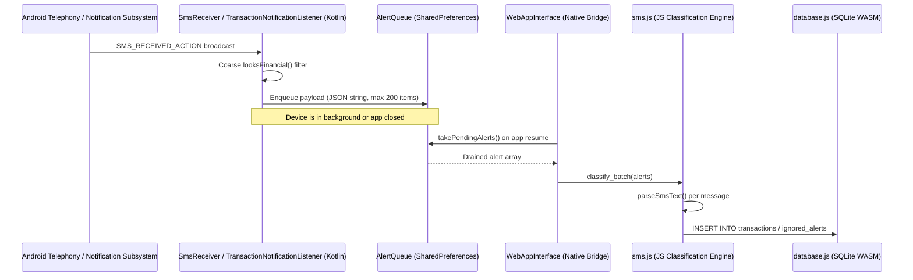
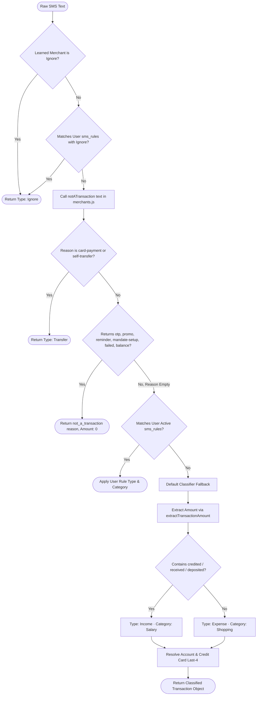

# Vitta Vriksha - SMS Classification & Detection Knowledge Base

This document provides a comprehensive technical knowledge base covering the SMS ingestion architecture, transaction extraction engine, root-cause failure modes for credit and loan messages, data schemas, privacy redaction protocols, and the dataset structuring pipeline required for fine-tuning compact language models (including ternary weight LLMs) or distilling deterministic rule engines.

---

## 1. System Overview & Ingestion Pipeline

Vitta Vriksha operates as a zero-network, offline-first application on Android. The ingestion of bank alerts flows through a distinct two-layer boundary: Kotlin native shell and Web layer (ES Modules + SQLite WASM).



### 1.1 Native Capture Layer
- **Source Files**: 
  - [SmsReceiver.kt](../app/src/main/java/com/chikatistudio/vittavriksha/SmsReceiver.kt)
  - [TransactionNotificationListener.kt](../app/src/main/java/com/chikatistudio/vittavriksha/TransactionNotificationListener.kt)
  - [AlertQueue.kt](../app/src/main/java/com/chikatistudio/vittavriksha/AlertQueue.kt)
  - [WebAppInterface.kt](../app/src/main/java/com/chikatistudio/vittavriksha/WebAppInterface.kt)
- **Coarse Filter (`looksFinancial`)**:
  - Currency pattern: `/(?:rs\.?|inr|₹)\s*\.?\s*\d/i`
  - Marker tokens: `debited`, `credited`, `spent`, `sent rs`, `received`, `withdrawn`, `payment`.
  - If a message matches either the currency pattern or marker list, it is written to `AlertQueue`.
- **Alert Queue Storage**:
  - Saved as a serialized JSON array in Android SharedPreferences (`vitta_vriksha_alerts`).
  - Strict FIFO capacity cap of 200 messages to prevent unbounded background memory or storage growth.
  - Historical bulk scans query `Telephony.Sms.Inbox.CONTENT_URI` up to 25,000 messages via `readSmsInbox(days)`.

### 1.2 JavaScript Classification Pipeline
- **Source Files**:
  - [sms.js](../app/src/main/assets/www/js/backend/sms.js)
  - [merchants.js](../app/src/main/assets/www/js/backend/merchants.js)
  - [database.js](../app/src/main/assets/www/js/backend/database.js)
- **Context Builder (`buildClassificationContext`)**:
  - Loads active `sms_rules` ordered by type (`Ignore` rules prioritized first, then ID ascending).
  - Loads `merchant_rules` into memory map (`merchantMap`).
  - Pre-caches `asset_accounts` and `credit_cards` for fast entity resolution.

---

## 2. Current Classification Decision Flow

The core classification function is `parseSmsText(text, sender, receivedAt, context)` in `sms.js`. It runs through the following hierarchical sequence:



### 2.1 Non-Transaction Filter (`notATransaction` in `merchants.js`)

The filter tests categories of non-movement in this order:
1. **OTP Guard**: Matches `\botp\b`, `one-time password`, `verification code` (excluding safe notifications like `without PIN/OTP`).
2. **Self Transfer & Bill Payment**: Matches credit card bill credits and FASTag recharges, returning `card-payment` or `self-transfer`.
3. **Failed / Declined**: Matches `failed`, `declined`, `reversed`, `could not be processed`.
4. **Completed Movement Bypass**:
   ```javascript
   if (COMPLETED_MOVEMENT.test(text) && !HEDGED.test(text)) return '';
   ```
   If a text contains a past-tense currency movement and is not hedged, it immediately bypasses all promo and reminder filters.
5. **Setup, Reminders, Spam & Promos**:
   - `MANDATE_SETUP`: Registration of NACH, ACH, e-mandates.
   - `REMINDER`: Due dates, upcoming autopay, bills generated.
   - `SPAM_AND_PROMO`: Pre-approved loans, credit card upgrades, discounts, betting, job spam.

---

## 3. Failure Mode Analysis: Credit & Loan Messages

The current heuristic engine encounters systematic classification errors with loan and credit messages. Below is the technical breakdown of each failure mode.

### 3.1 Failure Mode A: Pre-Approved Loan Ads Classified as Real Income
- **Observed Behavior**: Promotional messages from banks or fintechs (e.g., Bajaj, HDFC, KreditBee, MoneyView) stating pre-approved loan sums (such as ₹5,00,000) are accepted as transactions and filed under `Salary` or `Income`.
- **Root Cause**:
  - The bypass logic `COMPLETED_MOVEMENT.test(text) && !HEDGED.test(text)` fires prematurely.
  - Phrasings like *"Rs 5,00,000 has been credited to your pre-approved loan wallet"* or *"Rs 2,00,000 deposited into your special credit line"* trigger `COMPLETED_MOVEMENT`.
  - If the advertisement omits standard hedge tokens present in `HEDGED` (such as `due on`, `will be`, `apply now`), `notATransaction` returns `''` (valid transaction).
  - The message falls through to the Default Classifier.
  - In `sms.js`, `text.includes('credited')` evaluates to true, assigning `Type: 'Income'` and `Category: 'Salary'`.

### 3.2 Failure Mode B: Credit Card Loans (Jumbo Loans / Insta Loans)
- **Observed Behavior**: Credit card loan disbursals or marketing alerts are improperly filed as ordinary credit card spending or credit card bill payments.
- **Scenario Breakdown**:
  - **Marketing Alerts**: *"Instant cash loan of Rs 1,50,000 pre-approved on your Card ending 4321. Pay low EMI of Rs 3,400."*
    - The parser detects `Card ending 4321` and associates the credit card record.
    - If `SPAM_AND_PROMO` misses the syntax, it registers as a credit card spend or card payment.
  - **Actual Disbursal**: *"Rs 1,00,000 disbursed to your savings A/C 9988 against your credit card loan."*
    - This is a capital inflow accompanied by a liability, not operating income. Registering this as `Salary` distorts cashflow metrics.
  - **EMI Conversion**: *"Transaction of Rs 45,000 on Card 1234 has been successfully converted into 9 EMIs of Rs 5,420."*
    - The original purchase of ₹45,000 was already debited.
    - If the confirmation message is treated as a new transaction, either ₹45,000 or ₹5,420 is booked a second time, inflating expense totals.

### 3.3 Failure Mode C: Loan Disbursals vs EMI Repayments vs Mandates
- **Observed Behavior**: Confirmations of EMI receipts sent by lenders are classified as income.
- **Root Cause**:
  - When an EMI is paid via NACH auto-debit, the borrower receives two alerts:
    1. From bank: *"A/C xx1234 debited for Rs 14,500 towards EMI"* (Correctly identified as `Loans & EMI`, Expense).
    2. From lender: *"Received payment of Rs 14,500 towards Home Loan 0987. Outstanding balance: Rs 28,40,000."*
  - The second alert contains `Received payment` and `Rs 14,500`.
  - The keyword `received` causes the fallback classifier to guess `Income`, recording a duplicate phantom income entry that cancels out the actual expense.

### 3.4 Failure Mode D: Credit Limit Alterations
- **Observed Behavior**: Alerts regarding card limit upgrades (e.g., *"Your card limit has been enhanced to Rs 4,00,000"*) occasionally slip past filters when phrased with credit verbs.
- **Root Cause**:
  - Missing boundary checks between account balance, available limit, total limit, and transacted amounts.
  - The numeric extraction regex selects the largest number in the string when preposition anchors fail.

### 3.5 Failure Mode E: Masked Card Prefix vs Tail Digit Extraction (CRED Alerts)
- **Observed Behavior**: Notifications formatted as `4375-51XX-XXXX-6003` extracted `4375` (the leading Bank Identification Number / BIN) instead of `6003` (the last 4 digits).
- **Root Cause**:
  - The regex `/\b\d{4}[-\s]+[xX*]{2,}[xX*\d]*.../` assumed that every masked block begins with masking characters `[xX*]`.
  - In Indian card alerts (such as CRED), the second block `51XX` begins with unmasked digits (`51`), representing the 6-digit BIN `437551` (ICICI Visa).
  - The regex failed and fell back to `card number ([0-9]{4})`, grabbing the first 4 digits `4375` and creating a duplicate orphan card.
- **Deterministic Fix**:
  - Full-block masked card tokenizer: `/\b(?:\d{4}|[xX*]{4})[-\s]+[\dxX*]{4}[-\s]+[\dxX*]{4}[-\s]+(\d{4})\b/`.
  - Captures `6003` and negative lookahead `(?![-.][\dxX*])` in general number extractors to prevent prefix capture.

### 3.6 Failure Mode F: Credit Card Bill Payments Misclassified as Income
- **Observed Behavior**: Credit card payment confirmations stating *"payment of Rs.1.00 via UPI & the same has been credited to your SBI Credit Card"* were categorized as `Received` (`Income` -> `Other Income`).
- **Root Cause**:
  - Flat keyword matching checked for the verb `credited`, mapping directly to default income rules.
  - The instrument was a Credit Card (a liability), where incoming payments reduce debt rather than creating operating income.
- **Deterministic Fix**:
  - State-aware instrument guard: Inbound credits into credit cards (where `isCreditCard` is true) are strictly routed to `Transfer` (`Credit Card`), unless explicit refund or cashback markers are present.

### 3.7 Failure Mode G: Overdraft / Home Loan Mandate Credits Misclassified as Income
- **Observed Behavior**: Home loan overdraft/OD account alerts (e.g., *"BOI - Rs 71068.00 has been Credited (NACH DR OW) in your account XXXX0039 on 21-09-2026.Avl Bal -9898954.00"*) were classified as `Received` (`Income` -> `Other Income`).
- **Root Cause**:
  - When an EMI is debited from a salary account and paid outward (NACH DR OW) into a loan account, the receiving lender issues a credit alert to the borrower.
  - Naive keyword rules matched `Credited` and booked ₹71,068 as monthly income, canceling out the actual EMI expense.
- **Deterministic Fix**:
  - Negative balance detection (`accountBalance < 0`) and NACH mandate tokens (`NACH DR OW`, `loan a/c`, `overdraft`) classify incoming funds as `Expense` (`Loans & EMI`), preserving accurate net worth and cash flow calculations.

### 3.8 Failure Mode H: Inter-Account Transfers & Matched UPI Reference Pairs
- **Observed Behavior**: Inter-account funds transfers (e.g., Standard Chartered `XX2219` debited ₹20,000 and credited to ICICI `XX8386`) were filed as `Spent` (`Expense` -> `Shopping`) on the debit leg and `Received` (`Income` -> `Other Income`) on the credit leg.
- **Root Cause**:
  - Outward transfers were treated as POS retail merchant debits.
  - Inward transfers from the user's own name (`from SENDER NAME`) or sharing the exact same 12-digit UPI reference number (`627865226916`) were treated as new income.
- **Deterministic Fix**:
  - `debited ... and credited to a/c` patterns mapped to `self-transfer` (`Transfer` -> `Transfer`).
  - Inward credits from user/family members (`from SENDER NAME`) mapped to `Transfer` (`Transfer`).
  - UTR-paired transactions recognized as transfer pairs with 0 net cash flow impact.

### 3.9 Architectural Analysis: Hard Rules vs Tiny LLMs vs spaCy
- **spaCy (NLP / Named Entity Recognition)**:
  - Python-only: Requires bundling CPython/Chaquopy into Android, bloating APK by ~80-120MB with high battery drain and cold-start latency.
  - Grammatical entities (PERSON, ORG) do not resolve financial transaction semantics (e.g., distinguishing NACH DR OW debt reduction from salary income).
- **Tiny LLMs (On-device SLMs e.g. SmolLM, MobileBERT, Phi-3)**:
  - High resource footprint: 500MB-1GB model weights even with 4-bit quantization.
  - Prohibitive latency: 200-500ms per inference takes 15-30 minutes of continuous mobile CPU/NPU churn across a 5,000-message SMS inbox.
  - Hallucination risk: Non-deterministic arithmetic (e.g., misreading CRED coin rewards as cash amounts or mutating account numbers).
- **Production Solution: Deterministic Semantic Slot Filling**:
  - Finite State Automaton evaluating: (1) Instrument Type (Card, Loan, Bank), (2) Movement Direction, and (3) Counterpart Entity.
  - Sub-millisecond performance (< 0.2ms per SMS), 0 MB memory overhead, 100% deterministic reproducibility, zero network dependency.

---

## 4. Current Data Model & Persistence Schemas

All SMS interactions, rules, and outcomes interface with SQLite through `database.js`.

### 4.1 Schema: `transactions`
```sql
CREATE TABLE IF NOT EXISTS transactions (
    id INTEGER PRIMARY KEY AUTOINCREMENT,
    member_id INTEGER DEFAULT 1,
    account_id INTEGER,
    card_id INTEGER,
    date TEXT NOT NULL,                -- YYYY-MM-DD
    amount REAL NOT NULL,              -- Positive number
    currency TEXT DEFAULT 'INR',
    type TEXT NOT NULL,                -- Expense | Income | Transfer | Ignore
    category TEXT NOT NULL,            -- e.g. Loans & EMI, Groceries, Salary
    merchant TEXT,                     -- Display merchant name
    merchant_key TEXT,                 -- Normalized alphanumeric key
    description TEXT,                  -- Optional notes or reference
    is_investment_outflow INTEGER DEFAULT 0,
    raw_sms TEXT,                      -- Original alert string for deduplication
    is_ignored INTEGER DEFAULT 0,      -- Hidden from default ledger
    is_duplicate INTEGER DEFAULT 0,    -- Flagged duplicate
    created_at TEXT,
    FOREIGN KEY (member_id) REFERENCES family_members(id),
    FOREIGN KEY (account_id) REFERENCES asset_accounts(id),
    FOREIGN KEY (card_id) REFERENCES credit_cards(id)
);
```

### 4.2 Schema: `sms_rules`
```sql
CREATE TABLE IF NOT EXISTS sms_rules (
    id INTEGER PRIMARY KEY AUTOINCREMENT,
    rule_name TEXT NOT NULL,
    sender_keyword TEXT,               -- Substring match against sender header (e.g. 'HDFCBK')
    body_trigger TEXT NOT NULL,         -- Word-bounded trigger string
    transaction_type TEXT NOT NULL,    -- Expense | Income | Transfer | Ignore
    category_name TEXT DEFAULT 'Groceries',
    regex_pattern TEXT,                -- Regex containing capture group for amount
    is_active INTEGER DEFAULT 1
);
```

### 4.3 Schema: `merchant_rules`
```sql
CREATE TABLE IF NOT EXISTS merchant_rules (
    merchant_key TEXT PRIMARY KEY,     -- Normalized form from merchantKey()
    category_name TEXT NOT NULL,
    transaction_type TEXT DEFAULT 'Expense',
    display_name TEXT,
    source TEXT DEFAULT 'user',
    hits INTEGER DEFAULT 0,
    updated_at TEXT
);
```

### 4.4 Schema: `ignored_alerts`
```sql
CREATE TABLE IF NOT EXISTS ignored_alerts (
    body TEXT PRIMARY KEY,             -- Raw SMS body
    ignored_at TEXT
);
```

### 4.5 Schema: `loans` and `credit_cards`
- **`loans`**: Holds `loan_type`, `principal_amount`, `current_outstanding`, `interest_rate`, `tenure_months`, `monthly_emi`, `linked_merchant_key`, `debit_day`.
- **`credit_cards`**: Holds `bank`, `card_name`, `last_4`, `total_limit`, `available_limit`, `current_balance`, `linked_merchant_key`.

---

## 5. SMS Dump Sanitization & Redaction Protocol

Before processing personal SMS dumps or submitting them for dataset construction, sensitive personal identifiers (PII) must be masked. The project maintains an existing reference implementation in [scripts/clean-sms.mjs](../scripts/clean-sms.mjs).

### 5.1 Redaction Transformations
1. **Account / Card / Tag Numbers**:
   - Matches: `a/c`, `acct`, `account`, `card ending`, `card no`, `tag`, `xx`, `***`.
   - Transformation: Retain instrument label, replace numeric sequence with `XXXX`.
2. **UPI Handles & VPA**:
   - Pattern: `[\w.\-]{2,}@[a-z]{2,}`
   - Transformation: `handle@upi`.
3. **Reference / UTR / Transaction IDs**:
   - Pattern: `\b[A-Z]{0,6}\d{7,}\b` or `\b\d{5}[A-Z0-9]{5,}\b`.
   - Transformation: `REF`.
4. **Closing Balances & Limits**:
   - Pattern: `(?:avl|available|total|clear)\s*bal[:\s]*[\d,]+(?:\.\d+)?`
   - Transformation: `avl bal XXXX` (to ensure balance figures are not mistaken for transaction amounts during training).
5. **Personal Names in Transfer Narrations**:
   - Pattern: Words following `NEFT`, `IMPS`, `RTGS`, `trf to` matching person name shapes.
   - Transformation: `REDACTED`.

---

## 6. Structured Dataset Schema for Fine-Tuning & Evaluation

When converting the raw SMS dump into training and evaluation sets, each record should conform to the following JSON schema.

### 6.1 JSONL Record Specification
```json
{
  "id": "sms_0001",
  "sender": "VK-HDFCBK",
  "timestamp": 1724502800000,
  "raw_text": "Sent Rs. 450.00 from HDFC Bank A/C ending XXXX to Swiggy on 24-08-2026 via UPI REF. Avl Bal Rs. XXXX.",
  "ground_truth": {
    "is_financial": true,
    "disposition": "transaction",
    "rejection_reason": null,
    "transaction_type": "Expense",
    "category": "Dining",
    "amount": 450.00,
    "currency": "INR",
    "date": "2026-08-24",
    "merchant_raw": "Swiggy",
    "merchant_normalized": "swiggy",
    "instrument": {
      "type": "bank_account",
      "issuer": "HDFC Bank",
      "last_4": "XXXX"
    },
    "loan_meta": null
  }
}
```

### 6.2 Target Label Taxonomies

#### Disposition Field
- `transaction`: Real movement of funds that should be recorded in the ledger.
- `promo_loan`: Loan offer, pre-approved loan marketing, credit limit ad.
- `promo_general`: General advertisement, discounts, coupons.
- `reminder`: Upcoming bill reminder, pre-debit advice, due date notice.
- `mandate_setup`: E-mandate / NACH registration confirmation.
- `otp`: One-time password or security verification.
- `balance_update`: Balance notification without financial debit or credit.
- `card_payment`: Self-transfer paying a credit card bill.
- `self_transfer`: Movement between user's own accounts or FASTag top-up.
- `emi_conversion`: Restructuring of an existing purchase into installments.
- `failed`: Transaction failed, declined, or reversed.

#### Financial Type Field
- `Expense`: Outflow from user assets.
- `Income`: Real earnings (Salary, Freelance, Dividend, Interest, Cashback).
- `Transfer`: Neutral movement (Card bill payment, Demat funding, Self-transfer).
- `Loan_Disbursal`: Borrowing proceeds entering account (increases asset and liability).
- `Loan_Repayment`: Installment clearing principal and interest.
- `Ignore`: Non-actionable or excluded record.

#### Loan Metadata Field (`loan_meta`)
For messages involving loans or credit lines:
```json
{
  "loan_type": "personal_loan | home_loan | credit_card_loan | emi_conversion | pre_approved_ad",
  "principal": 500000,
  "emi_amount": 12500,
  "tenure_months": 48,
  "is_offer_only": true
}
```

---

## 7. Model Strategy & Rule Distillation Architecture

Because Vitta Vriksha is an offline Android application without internet permissions, any logic derived from an SMS dump must operate within strict on-device constraints.

```mermaid
graph TD
    Dump[User Raw SMS Dump] --> Redact[Sanitize & Redact PII (clean-sms.mjs)]
    Redact --> Label[Annotate Ground Truth (Disposition, Type, Amount, Merchant)]
    Label --> Dataset[Structured JSONL Dataset]

    Dataset --> PathA[Path A: Deterministic Rule Distillation]
    Dataset --> PathB[Path B: Small / Ternary LLM Fine-Tuning]

    PathA --> RegexRefine[Refine COMPLETED_MOVEMENT, HEDGED, SPAM_AND_PROMO]
    RegexRefine --> DictAho[Update Aho-Corasick Dictionary in merchants.js]
    RegexRefine --> UnitTests[Generate Exhaustive Node.js Test Matrix]
    UnitTests --> FastDeploy[Zero Runtime Overhead ES Module Update]

    PathB --> FineTune[Fine-tune BitNet b1.58 / Ternary Model or TinyLlama / MobileBERT]
    FineTune --> EvalMatrix[Benchmark Accuracy, Precision, Recall on Test Split]
    EvalMatrix --> ONNXExport[Quantize & Export to ONNX / TFLite < 5MB]
    ONNXExport --> NativeEngine[Native Android Inference Engine via ONNX Runtime]
```

### 7.1 Path A: Deterministic Rule Distillation (Immediate & Zero-Overhead)
- **Mechanism**: The labeled dataset is analyzed to identify exact n-gram patterns, syntactic structures, and failure edge cases.
- **Implementation**:
  - Refine `HEDGED` and `SPAM_AND_PROMO` in `merchants.js` to catch all loan ad variants before `COMPLETED_MOVEMENT` can misfire.
  - Introduce dedicated `LOAN_AD_TOKENS` (e.g., `pre-approved loan`, `loan limit`, `avail loan`, `disbursed in min`, `instant cash`).
  - Introduce separate logic for `LOAN_DISBURSAL` and `EMI_CONVERSION`.
  - Add comprehensive regression assertions to `test/merchants_sms.test.mjs` and `test/installment_emi_ignore_rules.test.mjs`.
- **Advantages**: Zero increase in APK size, zero battery overhead, sub-millisecond execution in pure JavaScript.

### 7.2 Path B: Small LLM / Ternary Model (BitNet b1.58 / Compact Classifier)
- **Concept**: Train a tiny specialized model (e.g., BitNet 1-bit / 1.58-bit weights, or quantized MobileBERT / TinyLlama) purely on SMS intent classification.
- **Feasibility & Trade-offs**:
  - A standard 7B or 3B LLM cannot be bundled into a lightweight Android app (app size limit, RAM constraints on low-end devices).
  - A specialized 1.58-bit ternary model or a 5MB MobileBERT / FastText / TFLite classifier can run on-device.
  - Output constraint: Model must output structured JSON or a discrete class enum (`0` to `10`) rather than freeform prose.
- **Workflow**:
  - The model serves as the ground-truth validator or runs on developer hardware to auto-generate regex rules.
  - If embedded in the Android app, it sits behind `WebAppInterface` using ONNX Runtime Android or TensorFlow Lite C++ bindings.

### 7.3 Path C: Hybrid Two-Stage Pipeline
- **Stage 1 (Fast Regex & Automaton)**: 95% of standard debits and credits pass through the deterministic matcher in `< 1ms`.
- **Stage 2 (Heuristic / Distilled Fallback)**: Ambiguous messages or those matching loan tokens undergo secondary rule evaluation or are flagged for explicit user review in `rules.js` with clear context tags.

---

## 8. Test Harness & Regression Suite

The repository contains an extensive automated test suite running on Node.js without Android runtime dependencies.

### 8.1 Key Test Files
- [test/merchants_sms.test.mjs](../test/merchants_sms.test.mjs): Core tests for `merchantKey`, `notATransaction`, `extractMerchant`, `categoryForMerchant`, `parseSmsText`.
- [test/installment_emi_ignore_rules.test.mjs](../test/installment_emi_ignore_rules.test.mjs): Tests for EMI classification, ignore rules, duplicate marking.
- [test/recurring_loan_classification.test.mjs](../test/recurring_loan_classification.test.mjs): Detection of recurring loans, clubbed mandates, credit card commitments.
- [test/sms_rule_tester_view.test.mjs](../test/sms_rule_tester_view.test.mjs): UI test harness for manual SMS rule testing.

### 8.2 Executing Tests
```bash
# Run entire backend test suite
npm test
# or
./scripts/dev test

# Run style guideline & linter checks
node tools/check-style-guidelines.mjs
# or
npm run lint
```

---

## 9. Prepared Workflow for User SMS Dump Ingestion

When the user provides their SMS dump, the following sequence will be followed:

1. **Ingest & Sanitize**:
   - Parse dump format (CSV, JSON, or text export).
   - Run redaction pass via `scripts/clean-sms.mjs` protocol to strip phone numbers, account numbers, and counterpart identities while preserving message shapes.
2. **Partition & Annotate**:
   - Segregate messages into:
     - Clear transactions (debits/credits).
     - Loan advertisements and credit card loan promotions (the primary target).
     - Genuine loan disbursals and repayments.
     - Reminders, OTPs, and system notices.
3. **Analyze Edge Cases**:
   - Extract all false-positive loan patterns that bypass current `notATransaction` filters.
   - Catalog token co-occurrences (e.g., words appearing alongside `credited` in loan promotions).
4. **Develop Solution**:
   - Construct refined regex guards and test datasets.
   - Formulate training pairs for compact model exploration if pursuing on-device neural classification.
   - Validate that 100% of existing tests pass and new loan ad test cases are cleanly rejected without dropping valid transactions.

---

## 10. Multi-Channel Deduplication, Loan Liabilities & Remittance Rules

### 10.1 Multi-Channel Account Discovery & PSP Header Reconciliation
- **Problem**: When transactions occur via third-party UPI PSPs (PhonePe, Google Pay, SBI BHIM, Axis UPI), the SMS sender header often reflects the PSP rather than the underlying banking institution. Additionally, generic messages omitting the bank name in the SMS body produced dual accounts for the same 4-digit card/account (e.g. `Bank A/c ending 2219` and `Standard Chartered Bank Savings ending 2219`).
- **Solution**:
  1. Candidate accounts are grouped by `last_4` for all 4-digit instruments.
  2. Issuers are ranked and aggregated across all messages for that identifier. Actual banking institutions (`Standard Chartered Bank`, `ICICI Bank`, `Punjab National Bank`) take strict precedence over generic `'Bank'` and PSP aggregators (`PhonePe`, `Google Pay`, `Amazon Pay`).
  3. The `discovered` list guarantees strict `last_4` uniqueness: no instrument is ever emitted more than once.

### 10.2 Loan Account Classification vs Net Worth Inflation
- **Problem**: Overdraft or home loan accounts (e.g. `BOI - Rs 71068.00 has been Credited (NACH DR OW) ... Avl Bal -9898954.00`) report negative available balances. If parsed as positive numbers and added to `asset_accounts`, they artificially inflate Net Worth by lakhs or crores. If converted to credit cards, they distort card liabilities.
- **Solution**:
  1. `extractAccountBalanceFromText` explicitly preserves negative signs and checks for `DR` / `CR` suffixes.
  2. Accounts with negative balances or loan/NACH indicators are identified as `isLoan: true` and `instrument_type = 'loan'`.
  3. When saved, loan items insert into the `loans` table with `direction: 'borrowed'`, `principal_amount`, and `monthly_emi`, properly calculating liabilities in Net Worth (`Net Worth = Assets - Liabilities`).
  4. `autoUpdateAccountFromSms` never applies negative balances to asset accounts, and `autoUpdateLoanFromSms` updates active loan balances.

### 10.3 Inward Investment Redemptions vs Outward Investment Outflows
- **Problem**: Redemptions from mutual funds or stock sales (e.g. `credited:Rs. ... NSE CL`) contain investment keywords, causing them to be categorized as `Investment Outflow` despite bringing money *into* the user's account.
- **Solution**:
  - `isInvestOutflow = known.category === 'Investment Outflow' && !isCredit`.
  - Inward credits from investment entities are categorized as `Income` / `Other Income` or `Transfer`, never as money leaving the user.

### 10.4 Outward Remittance Delivery Acknowledgments
- **Problem**: Outward NEFT/RTGS payments (e.g. `ICICI BANK NEFT Transaction ... credited to the beneficiary account`) contain words like `credited to`, causing them to misclassify as `Income` -> `Salary`.
- **Solution**:
  - `isBeneficiaryRemittance = /credited to (?:the )?beneficiary|credited to payee|debited .* credited to/i.test(text)`.
  - These delivery acknowledgments are categorized as `Transfer` or `Expense`, preventing false salary or income entries.

### 10.5 Generic Credit Fallback
- Generic credit notifications (`credited to`, `credited with`, `credited by`, `credit alert`, `Credit`) default to `Other Income` rather than `Salary`, while explicit corporate payroll patterns (`Salary credit`, `Payroll credit`, `deposited in`) retain `Salary`.

### 10.6 Mobile UI Account Identifier Visibility
- In `sms-ingest.js`, 4-digit identifiers (`XX${last_4}`) are displayed in dedicated, unclipped badges adjacent to the institution name.
- Discovered account cards are interactive (`cursor: pointer`), allowing users to tap any card to open `openDiscoveredAccountSheet` to inspect sample SMS text, view debit/credit volume, and customize classification.
